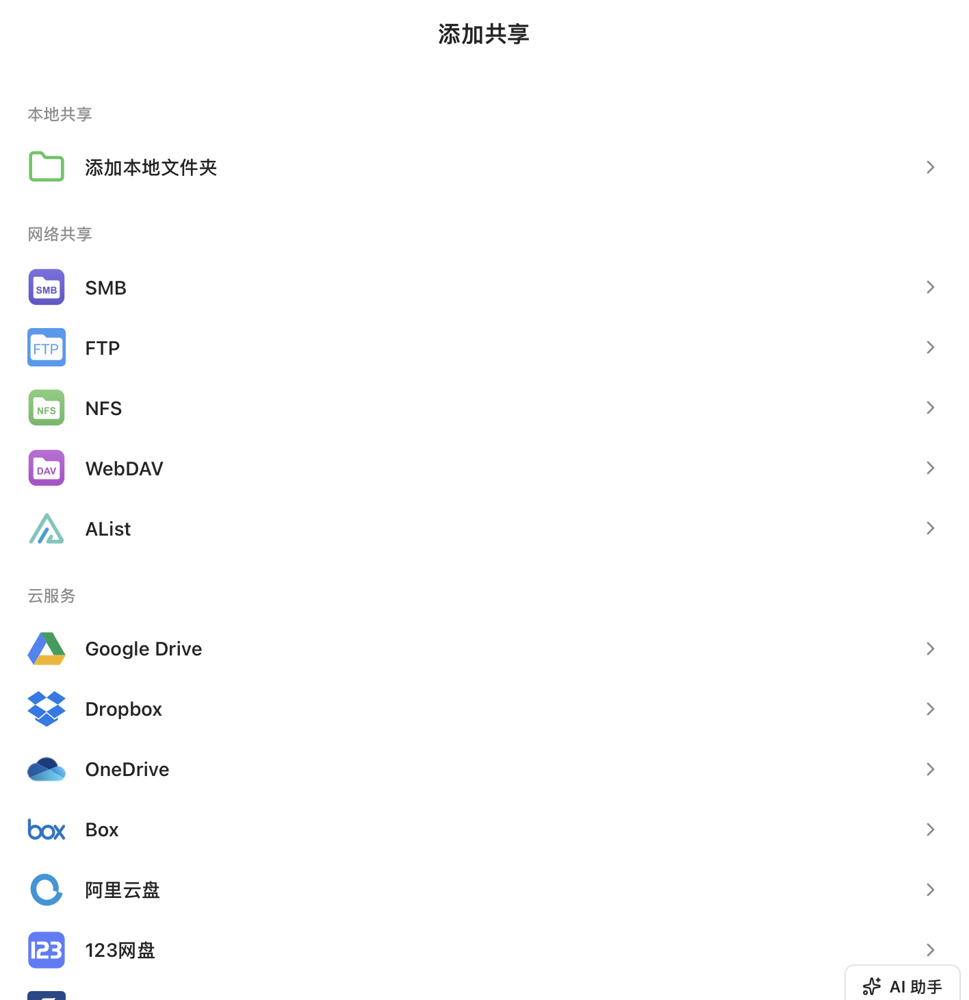
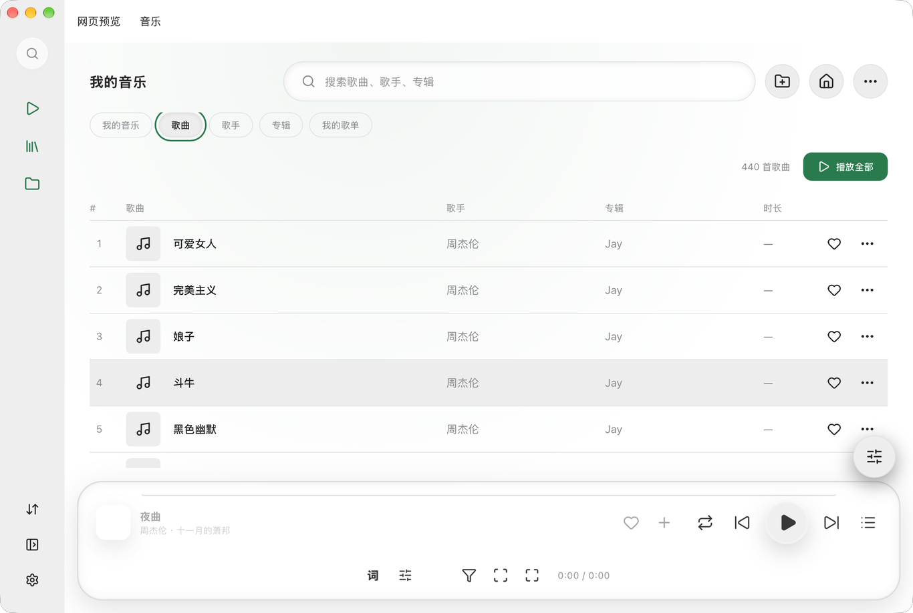

<p align="center"></p>

# BoxPlayer

Bring the media on your computer, cloud drives, NAS, and media servers into one library. Find something to watch, pick up a series, put on music, or open a book.

[Install BoxPlayer](#install-boxplayer) · [Tauri release progress](https://github.com/gaozhangmin/boxplayer/issues/540) · [中文](README.md)


*Captured in the macOS Tauri development app. Movie artwork and information are from TMDB.*

## Build a library from the media you already have

Connect a local folder, cloud drive, or Jellyfin, Emby, or Plex server to browse and play its media. Scan your movie and TV folders to add posters, descriptions, seasons, and episodes. Pick up where you left off or browse your favorites, playlists, and categories.

Choose audio and subtitle tracks, change playback speed, or open media in a supported external player. Formats and playback features depend on your device, sources, and client.


## Let the cloud drive Agent prepare a plan

In the Tauri development app, open **AI Assistant** from Files or hand off a title from its detail page. The Agent can work with a folder, selected files, or a particular movie or show. Lock the context to keep the same scope while you browse elsewhere.

| What you want to do | What you can ask the Agent to do |
| --- | --- |
| Find files | Look for a movie across connected sources, inspect folders or shares, or check available storage. |
| Organize a series | Group episodes by season and preview folders, moves, and standardized filenames. |
| Review a share or follow a series | Inspect a share before choosing what to import, or track an acquisition task and new episodes. |
| Repeat a workflow | Use Recipes for tasks such as filing movies or batch renaming, and schedule plans for review. |


For changes that write to storage, review the proposed steps in the **plan diff**, choose which items to keep, and approve the plan. The Agent rechecks sources and destinations before applying supported changes. You can inspect the results and undo eligible changes. Search, import, and write permissions vary by provider and account.

The development app also offers optional local MCP access. For terminal workflows, see the [clouddrive-cli guide](clouddrive-cli/README.en.md) for file traversal, organization plans, and dry runs.

## Work with more than video

- **Files and transfers.** Connect accounts from services such as Google Drive, OneDrive, Dropbox, Aliyun Drive, Baidu Netdisk, 115, 123Pan, and Quark. Browse, upload, download, and import shares where supported. Network sources include SMB, NFS, WebDAV, and AList.
- **Music.** Browse songs, artists, albums, and playlists. Manage the playback queue and use particle visuals and lyrics.
- **Books and documents.** Read EPUB and PDF in the bookshelf, keep bookmarks and notes, and resume reading. Supported clients can preview documents and help answer questions about them.
- **Models and Pro.** Where the client supports it, connect your own model service or use hosted AI features available with BoxPlayer Pro.

<p>
  
  
</p>

## Install BoxPlayer

| Device | Download |
| --- | --- |
| iPhone, iPad, Mac, Apple TV | [App Store](https://apps.apple.com/us/app/boxplayer/id6739804060) |
| Android phones and tablets, Android TV | [BoxPlayer website](https://xbyvideohub.com/) |
| Windows, Linux, and macOS desktop | [GitHub Releases](https://github.com/gaozhangmin/boxplayer/releases) |

Each platform has its own client. Check the corresponding version for available features, supported sources, and installers.

## Tauri desktop development

BoxPlayer is rebuilding its desktop app with **Tauri 2**. Vue runs in the system WebView, with Rust providing desktop windows, data storage, and media access. The macOS development app embeds libmpv. The Tauri screenshots above were taken in the running macOS development app.

**The first Tauri release is in preparation.** The Agent and other features are still being integrated. Follow the [release announcement](https://github.com/gaozhangmin/boxplayer/issues/540) for platform support and installers. The new desktop source lives in [`tauri-app/`](tauri-app/) on `main`. The existing desktop code is maintained on the [`electron` branch](https://github.com/gaozhangmin/boxplayer/tree/electron).

Install Node.js 22.12 or later, pnpm 10.32.1, Rust, and your platform's Tauri prerequisites. Reuse your app registration configuration and set `BOXPLAYER_REGISTRATION_FILE` if needed. See the [development guide](tauri-app/README.md) for app registration, macOS signing, and the playback runtime.

```sh
cd tauri-app
pnpm --ignore-workspace install --frozen-lockfile
pnpm tauri dev
```

Run `pnpm typecheck` and `pnpm test` for frontend checks. See the [migration notes](docs/tauri-migration/progress.md) for implementation and platform details.

## Contribute

Include your client version, operating system, source type, and reproduction steps when reporting an issue. [GitHub Issues](https://github.com/gaozhangmin/boxplayer/issues) · [Telegram](https://t.me/+wjdFeQ7ZNNE1NmM1)

BoxPlayer builds on [aliyunpan](https://github.com/liupan1890/aliyunpan) and uses [MediaScout](https://github.com/fancydirty/mediary-scout) for media acquisition. The project is licensed under the [GPL-3.0](LICENSE). Use media you have the right to access and follow the terms of your connected services.
