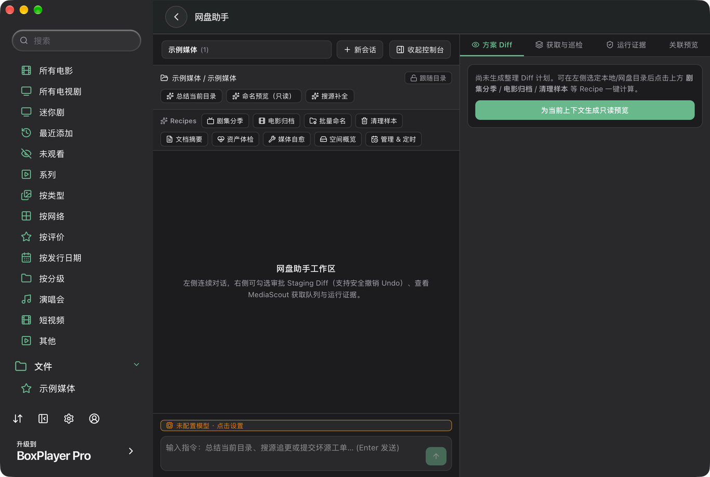

<p align="center"></p>

# BoxPlayer

<p align="center">One media player for your phone, tablet, TV, and computer. Bring together cloud drives, media servers, music, books, and AI tools.</p>

<p align="center">
  <a href="./README.md">中文</a> · English ·
  <a href="https://xbyvideohub.com/">Website and downloads</a> ·
  <a href="https://github.com/gaozhangmin/boxplayer/releases">Desktop releases</a> ·
  <a href="https://github.com/gaozhangmin/boxplayer/issues/540">First Tauri release updates</a> ·
  <a href="./clouddrive-cli/README.en.md">CLI / MCP</a>
</p>

BoxPlayer is a cross-platform player for your personal media. It runs on iPhone, iPad, Mac, Apple TV, Android phones and tablets, Android TV, Windows, and Linux. Browse cloud drives and local files, connect NAS shares and Jellyfin, Emby, or Plex, and build a library for movies, TV shows, music, and books. Features vary by platform and version.

[Install BoxPlayer](#installation), then add an existing drive, folder, or media server to browse your content and build your library.

## The desktop app has been rebuilt with Tauri

The new desktop app uses **Tauri 2** to host its Vue interface in the system WebView. Native services connect accounts, files, transfers, and playback. The macOS development app embeds libmpv. Tauri source lives in [`tauri-app/`](tauri-app/) on the default `main` branch. The existing Electron desktop app is on the [`electron` branch](https://github.com/gaozhangmin/boxplayer/tree/electron).

**The first Tauri release is in preparation.** The Agent features below are from the development preview and are still being integrated. The [release announcement](https://github.com/gaozhangmin/boxplayer/issues/540) will list supported platforms, cloud providers, and installers.

## New cloud drive Agent

Open **AI Assistant** in Files to ask about the current folder or selected files. Open the full Agent workspace to work across sources or follow longer tasks. Lock the context to keep a task focused on its original scope while you browse elsewhere.

| What you want to do | What you can ask |
| --- | --- |
| Find files and check storage | “Find this movie across my connected sources and check which drives have room.” |
| Organize a series | “Show me how you would group the episodes in this folder by season.” |
| Inspect a shared folder | “List the videos in this share so I can choose which ones to save.” |
| Follow a series | “Track this series and let me know when you find a new episode.” |
| Review file hygiene | “Check this folder for duplicate files and suggest clearer names.” |



*macOS development preview with local sample media.*

### Review changes before approving them

1. **Choose a scope.** Start from a folder or selected files. Lock the context when needed.
2. **Inspect the plan.** Review proposed folders, moves, and renames, and deselect the steps you want to skip.
3. **Approve the plan.** The Agent checks sources and destinations again before writing. Some higher-risk actions require an additional confirmation.
4. **Follow the results.** See task progress, execution records, and errors in the workspace. Eligible changes can be undone.

**Recipes** make repeated tasks such as organizing episodes, filing movies, and batch naming reusable. Schedules can prepare plans for your approval. The development preview also offers optional local MCP access, which is off by default. Search, import, write, and undo capabilities vary by provider and account permissions.

## What BoxPlayer can do

| Area | Main features |
| --- | --- |
| File management | Browse and search multiple cloud accounts, upload and download files, copy and move items, manage shares, and use the trash where supported. |
| Media library | Scan cloud and local folders and fetch posters and metadata. Browse movies, shows, seasons, episodes, cast, and categories. |
| Media servers | Connect Jellyfin, Emby, or Plex to browse, search, play, and pick up where you left off. |
| Video playback | Use the built-in player or supported external players such as MPV and IINA. Choose audio and subtitle tracks, including ASS/SSA, adjust speed, and resume playback. |
| Music | Browse songs, artists, albums, and playlists. Use the queue, particle player, lyrics, effects, and desktop lyrics where available. |
| Reading and Document AI | Read EPUB, PDF, and TXT. Use bookmarks, notes, and highlights, or ask questions about supported documents. |
| AI workspace | Find and analyze content, plan file organization, and review proposed writes before execution. |
| Automation | Use `clouddrive-cli` and its MCP server to work with cloud drives from the terminal or an AI client. |

### Cloud drives and other sources

- Cloud drives include Aliyun Drive, Baidu Netdisk, 123Pan, 115 Drive, Quark, PikPak, Google Drive, OneDrive, Dropbox, Box, China Mobile Cloud 139, Tianyi Cloud 189, and Guangya.
- Other sources include Jellyfin, Emby, Plex, SMB, NFS, WebDAV, AList, and local folders.
- Available operations depend on the client, provider, and account permissions.

### AI and Pro

Core file management, playback, music, reading, and CLI features are available for free. Pro mainly covers hosted AI, resource search quotas, and priority support. You can also configure your own OpenAI-compatible service or local model. Your provider handles any third-party API charges.

### CLI and MCP

`clouddrive-cli` can walk and search file trees, generate media organization plans, preview changes with a dry run, and log operations. Its MCP server makes these tools available to compatible AI clients. Install it independently with `npm install -g clouddrive-cli`. [CLI and MCP documentation](clouddrive-cli/README.en.md)

## Screenshots

The screenshots below show the existing Electron desktop app. The Tauri Agent workspace is shown above.

### Unified media library

Browse Continue Watching, favorites, and media categories. Open a title to view its artwork, seasons, episodes, cast, and play progress.


<p>
  
  
</p>

### Music and the particle player

Browse songs, artists, albums, or playlists, then open the particle player while you listen.

<p>
  
  
</p>

### Files, search, and AI

Browse and search across cloud sources in one workspace. AI tools can help find media, organize files, and read documents.

<p>
  
  
</p>

More screenshots · [Document AI](screenshot/pdf_ai.png) · [Local search](screenshot/search_local.png) · [Bookshelf](screenshot/book_home.png) · [Reader](screenshot/book_reader.png) · [AI reading](screenshot/book_reader_ai.png)

## Installation

| Device | Download |
| --- | --- |
| iPhone, iPad, Mac, Apple TV | [BoxPlayer on the App Store](https://apps.apple.com/us/app/boxplayer/id6739804060) |
| Android phones, tablets, and Android TV | [Android APK downloads](https://xbyvideohub.com/) |
| macOS, Windows, and Linux desktop | [Website downloads](https://xbyvideohub.com/) · [GitHub Releases](https://github.com/gaozhangmin/boxplayer/releases) |

Choose an installer for your operating system and processor architecture from the published downloads. Apple platforms also have a native App Store client. For Tauri installer availability, see the [first release announcement](https://github.com/gaozhangmin/boxplayer/issues/540).

## Development

Install Node.js 22.12 or later, pnpm 10.32.1, Rust, and the Tauri prerequisites for your platform. Reuse your existing app registration configuration and set `BOXPLAYER_REGISTRATION_FILE` to its path if needed. The [Tauri development guide](tauri-app/README.md) covers macOS signing and libmpv setup.

```sh
cd tauri-app
pnpm --ignore-workspace install --frozen-lockfile
pnpm tauri dev
```

`pnpm dev` opens the browser preview. Run `pnpm tauri dev` for native playback, accounts, system integration, and Agent development. Use a separate development data directory to preserve existing Electron data. Run `pnpm typecheck` and `pnpm test` for frontend checks.

Engineering details are in the [migration progress](docs/tauri-migration/progress.md) and [subsystem docs](docs/subsystems/README.md). For Electron development and packaging, see the [Electron README](https://github.com/gaozhangmin/boxplayer/tree/electron).

## Community and credits

- Include your OS, app version, source type, and reproduction steps when reporting an issue. [GitHub Issues](https://github.com/gaozhangmin/boxplayer/issues)
- [Telegram community](https://t.me/+wjdFeQ7ZNNE1NmM1) · [WeChat official account](screenshot/qrcode_wechat.jpg)
- BoxPlayer builds on [aliyunpan](https://github.com/liupan1890/aliyunpan). Global search integrates [PanHub](https://github.com/wu529778790/panhub.shenzjd.com) and media acquisition integrates [MediaScout](https://github.com/fancydirty/mediary-scout).
- BoxPlayer is licensed under the [GPL-3.0](LICENSE).

Use media you have the right to access and follow the terms of each connected service.
