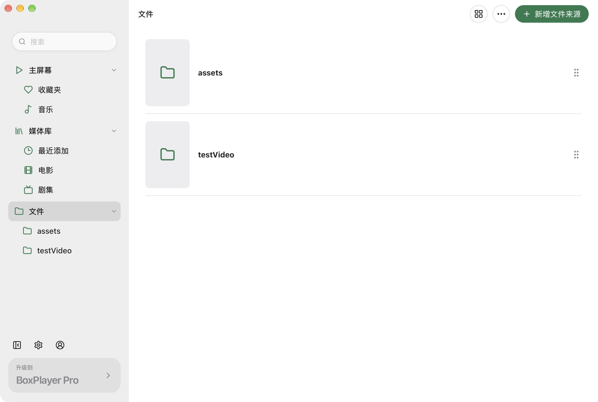

<p align="center"></p>

# BoxPlayer · Tauri Desktop

**Browse local files, cloud drives, and media servers in one place. Use the cloud drive Agent to find media, organize files, and follow tasks.**

[中文](README.md) · [First release updates](https://github.com/gaozhangmin/boxplayer/issues/540) · [GitHub Releases](https://github.com/gaozhangmin/boxplayer/releases) · [Website](https://boxplayer.cc/)

> **The first release is in preparation.** The Tauri source lives on `main`. The Agent features below are from the development preview and are still being integrated. The release announcement will list supported platforms, providers, and installers. The existing Electron desktop app is on the [`electron` branch](https://github.com/gaozhangmin/boxplayer/tree/electron).

## Cloud drive Agent

Open **AI Assistant** in Files to ask about the current folder or selected files. Open the full Agent workspace to work across sources or follow longer tasks. Lock the context to keep a task focused on its original scope while you browse elsewhere.

| What you want to do | What you can ask |
| --- | --- |
| Find files and check storage | “Find this movie across my connected sources and check which drives have room.” |
| Organize a series | “Show me how you would group the episodes in this folder by season.” |
| Inspect a shared folder | “List the videos in this share so I can choose which ones to save.” |
| Follow a series | “Track this series and let me know when you find a new episode.” |
| Review file hygiene | “Check this folder for duplicate files and suggest clearer names.” |

### Review changes before approving them

1. **Choose a scope.** Start from a folder or selected files. Lock the context when needed.
2. **Inspect the plan.** Review proposed folders, moves, and renames, and deselect any steps you want to skip.
3. **Approve the plan.** The Agent checks sources and destinations again before writing. Some higher-risk actions require an additional confirmation.
4. **Follow the results.** See task progress, execution records, and errors in the workspace. Eligible changes can be undone.

**Recipes** make repeated tasks such as organizing episodes, filing movies, and batch naming reusable. Schedules can prepare plans for your approval. The development preview also offers optional local MCP access, which is off by default. Search, import, write, and undo capabilities vary by provider and account permissions.

## Rebuilt with Tauri

Tauri 2 hosts the Vue interface in the system WebView. Native services connect accounts, files, the transfer queue, and the player. The macOS development app embeds libmpv. The library, Continue Watching, file browser, and transfers each have their own entry point.



*The Tauri development app on macOS, showing the file workspace.*

## Run from source

Install Node.js 22.12 or later, pnpm 10.32.1, Rust, and your platform’s Tauri prerequisites. See the [Tauri development guide](tauri-app/README.md) for macOS development signing and libmpv setup.

```sh
cd tauri-app
pnpm --ignore-workspace install --frozen-lockfile
pnpm tauri dev
```

`pnpm dev` opens the browser preview. Native playback, accounts, system integration, and the Agent run in the native app. Use a separate data directory for the development app to preserve existing Electron data. Run `pnpm typecheck` and `pnpm test` for frontend checks.

## Feedback and contributions

- Include your OS, app version or commit, source type, and steps to reproduce. [GitHub Issues](https://github.com/gaozhangmin/boxplayer/issues)
- Follow implementation progress and dated validation results. [Migration progress](docs/tauri-migration/progress.md) · [Subsystem docs](docs/subsystems/README.md)
- BoxPlayer builds on [aliyunpan](https://github.com/liupan1890/aliyunpan) and integrates [MediaScout](https://github.com/fancydirty/mediary-scout) for media acquisition. [GPL-3.0 license](LICENSE)
