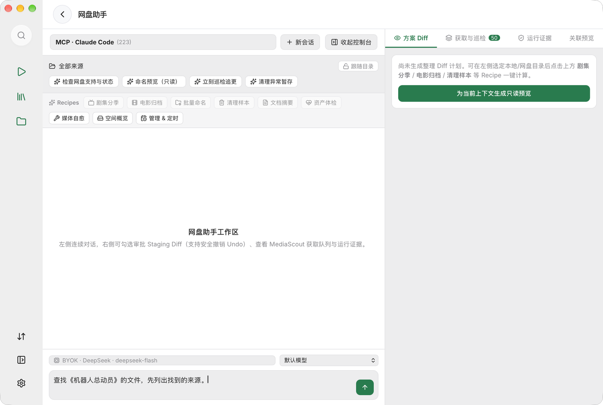
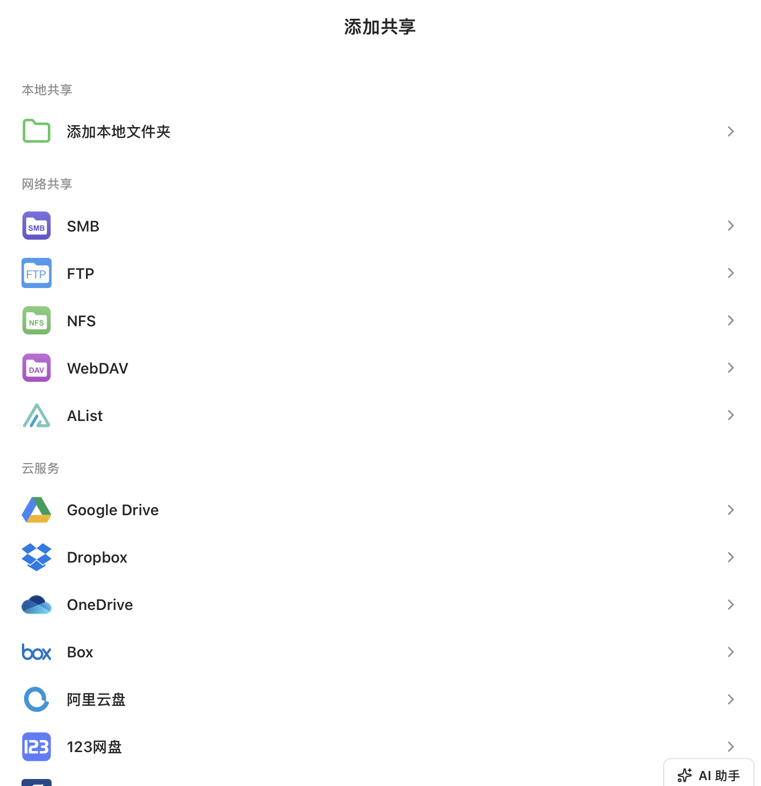
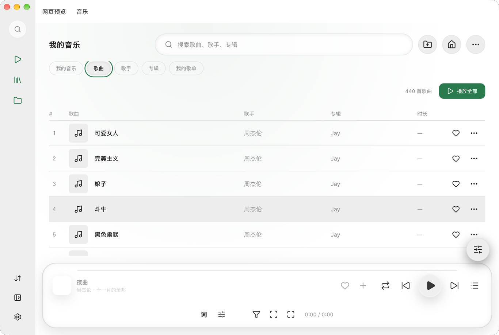

<p align="center"></p>

# BoxPlayer

把电脑硬盘、网盘、NAS 和媒体服务器里的内容放进同一座媒体库。找片、看剧、听歌、读书，都可以从 BoxPlayer 开始。

[下载与安装](#下载与安装) · [桌面新版进度](https://github.com/gaozhangmin/boxplayer/issues/540) · [English](README.en.md)


*macOS Tauri 开发版实屏。影片资料与图片来自 TMDB。*

## 把已有的片源变成媒体库

连接本地文件夹、网盘或 Jellyfin、Emby、Plex 后，可以直接浏览和播放。给 BoxPlayer 指定影视目录，它会扫描电影和剧集，补齐海报、简介和季集信息。用「继续观看」接着看，也可以按分类、收藏或播放列表浏览。

播放时可切换音轨和字幕、调整倍速，或在支持的客户端交给外部播放器。可用格式和播放能力取决于设备、来源与所用客户端。


## 让网盘助手先做计划

在 Tauri 开发版的文件页打开 **AI 助手**，或从影视详情把一部作品交给助手继续处理。它可以围绕当前目录、选中文件或指定作品查找和整理。需要去别的目录看文件时，可以锁定任务上下文。

| 想完成的事 | 可以交给助手的任务 |
| --- | --- |
| 找出文件 | 在已连接的来源里查找影片，查看目录、分享内容或可用空间。 |
| 整理剧集 | 按季分文件夹，预览标准化命名，以及要新建、移动或重命名的项目。 |
| 检查分享或跟进新集 | 先查看分享文件再选择转存内容，或跟踪影视获取和追更任务。 |
| 重复处理同类目录 | 使用 Recipes 复用电影归档、批量命名等流程，也可定时生成待审方案。 |



涉及写入时，可先在 **方案 Diff** 里逐项检查、取消勾选或批准。批准后，助手会再次核对来源和目标，再执行支持的操作。可查看执行结果，符合条件的操作可以撤销。搜索、转存和写入权限随提供商及账号而异。

开发版也提供可选的本地 MCP 接入。终端工作流可以使用独立的 [clouddrive-cli 文档](clouddrive-cli/README.md)了解文件遍历、整理计划与 dry run。

## 按自己的方式管理内容

- **文件与传输**。连接 Google Drive、OneDrive、Dropbox，以及阿里云盘、百度网盘、115、123、夸克等服务。管理多个账号，按来源支持情况浏览、上传、下载或转存。也可接入 SMB、NFS、WebDAV、AList 等网络共享。
- **音乐**。按歌曲、歌手、专辑和歌单浏览，建立播放队列，在粒子播放器中查看歌词。
- **阅读与文档**。把 EPUB、PDF 等图书放进书架，使用书签、批注和阅读进度。支持的客户端还提供文档预览和 AI 问答。
- **模型与 Pro**。按客户端提供的选项使用自己的模型服务，或使用 BoxPlayer Pro 中的托管 AI 等功能。

<p>
  
  
</p>

## 下载与安装

| 设备 | 获取方式 |
| --- | --- |
| iPhone、iPad、Mac、Apple TV | [App Store](https://apps.apple.com/us/app/boxplayer/id6739804060) |
| Android 手机、平板、Android TV | [官网下载](https://xbyvideohub.com/) |
| Windows、Linux、macOS 桌面版 | [GitHub Releases](https://github.com/gaozhangmin/boxplayer/releases) |

BoxPlayer 在不同设备上提供各自的客户端。功能、来源支持和安装包以对应版本为准。

## 新桌面端与源码

BoxPlayer 正在把桌面端从 Electron 重构为 **Tauri 2**。Vue 界面使用系统 WebView，Rust 原生层负责桌面窗口、数据存储和媒体访问。macOS 开发版使用嵌入式 libmpv 播放。本文的 Tauri 截图来自实际运行的 macOS 开发版。

**Tauri 首版正在准备中。** 网盘助手等能力仍在整合，首版支持范围和安装包以 [发布说明](https://github.com/gaozhangmin/boxplayer/issues/540) 为准。默认分支 `main` 的桌面工程位于 [`tauri-app/`](tauri-app/)。历史桌面工程的维护入口在 [`electron` 分支](https://github.com/gaozhangmin/boxplayer/tree/electron)。

准备 Node.js 22.12 或更新版本、pnpm 10.32.1、Rust 和目标系统的 Tauri 开发依赖。使用已有开发注册配置，必要时用 `BOXPLAYER_REGISTRATION_FILE` 指定配置文件。macOS 签名和播放器运行库的准备步骤见 [开发指南](tauri-app/README.md)。

```sh
cd tauri-app
pnpm --ignore-workspace install --frozen-lockfile
pnpm tauri dev
```

前端检查可运行 `pnpm typecheck` 和 `pnpm test`。工程进度和平台差异见 [迁移记录](docs/tauri-migration/progress.md)。

## 参与项目

提交问题时，请附上客户端版本、操作系统、来源类型和复现步骤。 [GitHub Issues](https://github.com/gaozhangmin/boxplayer/issues) · [Telegram](https://t.me/+wjdFeQ7ZNNE1NmM1)

BoxPlayer 基于 [aliyunpan](https://github.com/liupan1890/aliyunpan) 继续开发，影视获取集成 [MediaScout](https://github.com/fancydirty/mediary-scout)。项目采用 [GPL-3.0](LICENSE) 许可。请使用有权访问的媒体并遵循所连接服务的条款。
