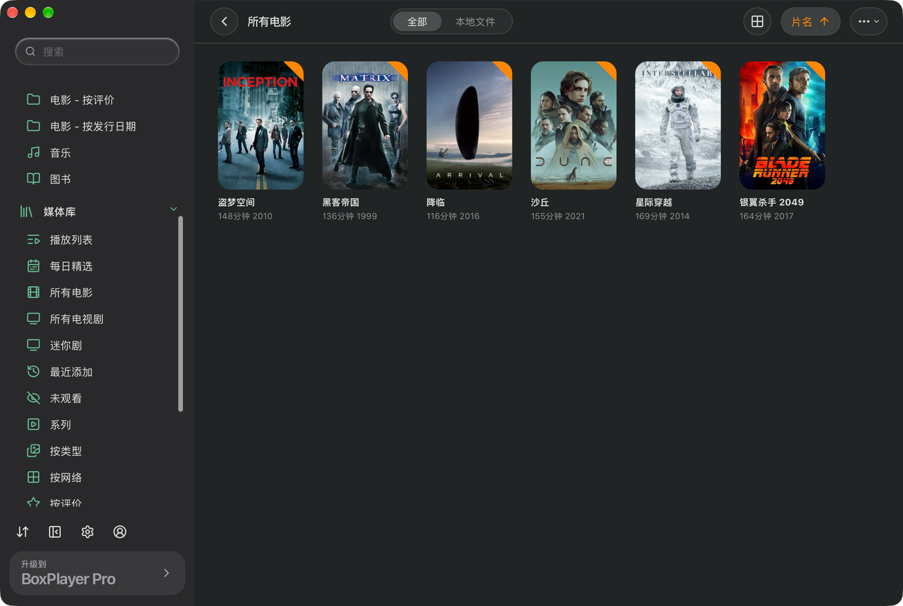
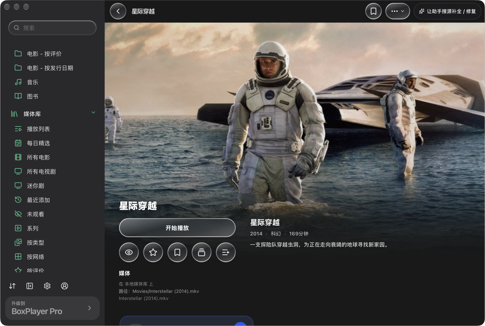
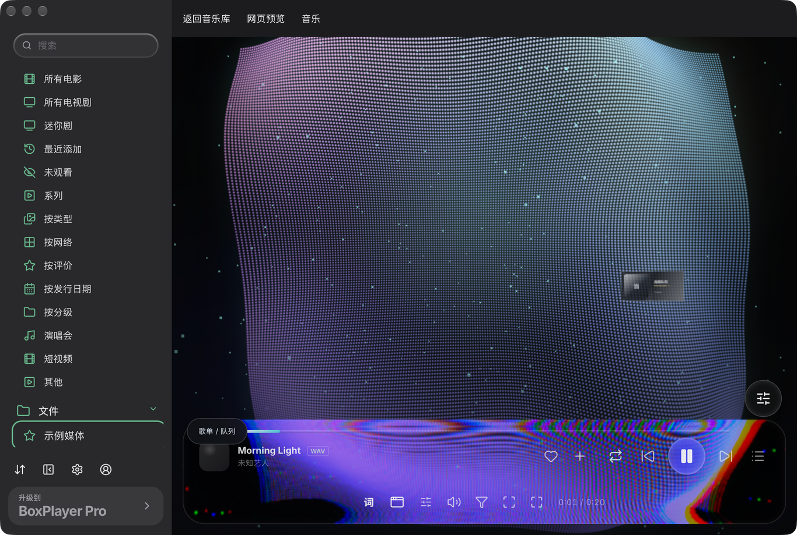
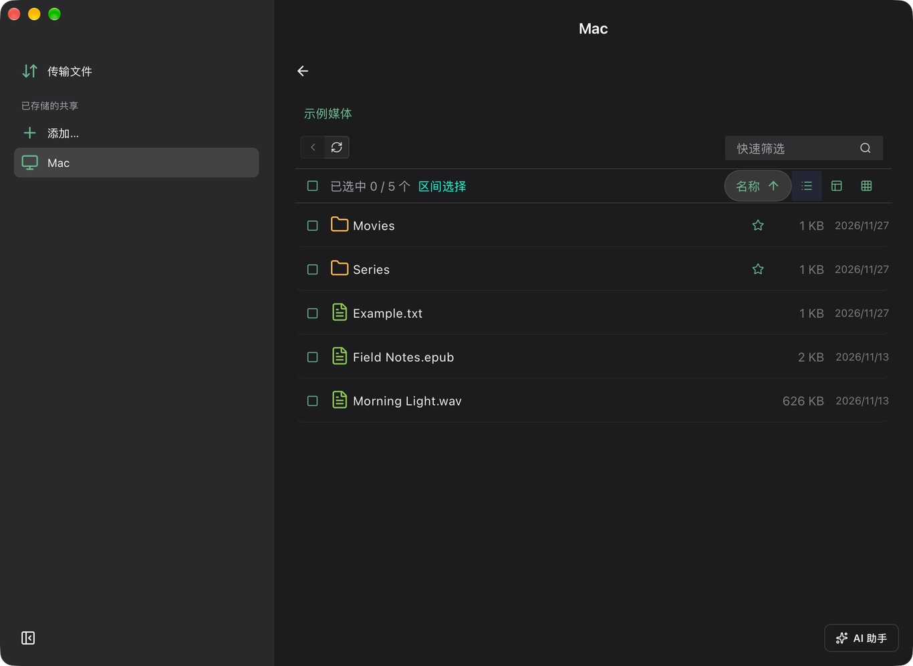

<p align="center"></p>

# BoxPlayer

<p align="center">跨手机、平板、电视与电脑的全平台播放器：把网盘、媒体服务器、音乐、阅读与 AI 放进同一个入口。</p>

<p align="center">
  中文 · <a href="./README.en.md">English</a> ·
  <a href="https://xbyvideohub.com/">官网及全平台下载</a> ·
  <a href="https://github.com/gaozhangmin/boxplayer/releases">桌面版 Releases</a> ·
  <a href="https://github.com/gaozhangmin/boxplayer/issues/540">Tauri 首版动态</a> ·
  <a href="./clouddrive-cli/README.md">CLI / MCP</a>
</p>

BoxPlayer 是面向个人媒体资产的全平台播放器，支持 iPhone、iPad、Mac、Apple TV、Android 手机与平板、Android TV、Windows 和 Linux。它把多个网盘、本地文件、NAS 和 Jellyfin / Emby / Plex 放进同一个入口，支持文件管理、媒体刮削与播放、音乐库、电子书阅读及 AI 辅助操作。各客户端的功能与发布节奏随平台而异。

第一次使用可以从 [安装](#安装) 开始。添加已有的网盘、文件夹或媒体服务器后，即可浏览内容并建立媒体库。

## 桌面端从 Electron 重构为 Tauri

BoxPlayer 的新桌面端采用 **Tauri 2**。Vue 界面运行在系统 WebView 中，通过原生服务连接账号、文件、传输队列和播放器。macOS 开发版内嵌 libmpv。新版源码位于默认分支 `main` 的 [`tauri-app/`](tauri-app/)，现有 Electron 桌面版位于 [`electron` 分支](https://github.com/gaozhangmin/boxplayer/tree/electron)。

**Tauri 首版正在准备中。** Agent 功能来自开发预览，相关实现仍在整合。安装包、支持的平台和网盘范围会在 [首版发布说明](https://github.com/gaozhangmin/boxplayer/issues/540) 更新。

## 新增网盘 Agent

在文件页打开 **AI 助手**，就能围绕当前目录或选中的文件提问。需要处理多个来源或跟进长任务时，打开完整的 **网盘助手** 工作区。锁定上下文后，可以去其他目录浏览，手头的任务仍使用原来的范围。

| 你想做什么 | 可以怎么说 |
| --- | --- |
| 查找和盘点 | “在已连接的来源里找这部影片，再看看哪些网盘还有空间。” |
| 整理影视文件 | “预览把当前目录里的剧集按季归档的方案。” |
| 检查分享与转存 | “列出这个分享里的视频，让我选择要保存的文件。” |
| 跟进影视资源 | “为这部剧创建追更任务，找到新一集时告诉我。” |
| 批量操作 | “检查这个目录的命名和重复文件，告诉我哪些值得整理。” |


*macOS 开发版，使用本地示例媒体。*

### 先看方案，再批准写入

1. **选定范围。** 从当前目录或选中的文件开始。需要时锁定上下文。
2. **查看改动。** 在方案面板里核对新建、移动、重命名等操作，按需取消其中的项目。
3. **确认执行。** Agent 在写入前再次检查来源和目标。部分高风险操作需要额外确认。
4. **追踪结果。** 在工作区查看任务进度、执行记录和失败原因。符合条件的操作支持撤销。

**Recipes** 把剧集分季、电影归档、批量命名等重复操作做成可复用流程。定时运行可以准备方案，需要写入时由你审批。开发版也提供可选的本地 MCP 接入，默认关闭。网盘的搜索、转存、写入和撤销能力取决于提供商及账号权限。

## 能做什么

| 场景 | 主要能力 |
|---|---|
| 文件管理 | 多账号云盘浏览、搜索、上传下载、复制移动、分享与回收站；第三方云盘按其 API 能力展示操作。 |
| 影视媒体库 | 扫描云盘和本地目录，补全海报与元数据；统一浏览电影、剧集、季集、演员和分类。 |
| 媒体服务器 | 连接 Jellyfin、Emby、Plex，浏览媒体库、继续观看、搜索并播放。 |
| 视频播放 | 内置播放器与 MPV / IINA 外部播放；支持音轨、字幕、ASS/SSA、倍速、连续播放和进度恢复。 |
| 音乐 | 歌曲、歌手、专辑、自建歌单与播放队列；粒子播放器、歌词、音效和桌面歌词。 |
| 阅读 | EPUB、PDF、TXT 等电子书；书签、笔记、高亮与 AI 阅读辅助。 |
| AI 工作台 | 搜索与分析内容、规划文件整理、文档问答；执行写入操作前提供确认。 |
| 自动化 | `clouddrive-cli` 和 MCP Server，适合终端及 AI Agent 调用云盘能力。 |

### 云盘与内容来源

- 云盘：阿里云盘 / Alipan、百度网盘、123 网盘、115、夸克、PikPak、Google Drive、OneDrive、Dropbox、Box、中国移动云盘 139、天翼云盘 189、光鸭云盘。
- 媒体与目录：Jellyfin、Emby、Plex、SMB、NFS、WebDAV、AList、本地文件夹。
- 可用操作取决于客户端、提供商和账号权限。

### AI 与 Pro

核心的文件管理、媒体播放、音乐、阅读和 CLI 功能可直接使用。Pro 主要覆盖需要持续服务端成本的内置 AI、资源搜索额度与优先支持。也可以配置自己的 OpenAI 兼容服务或本地模型；第三方 API 费用由对应服务商收取。

### 命令行与 MCP

`clouddrive-cli` 提供文件遍历、搜索、媒体整理计划、dry-run 预览、操作记录等能力，并能作为 MCP Server 供 AI 客户端使用。独立安装可运行 `npm install -g clouddrive-cli`。使用方法见 [CLI / MCP 文档](clouddrive-cli/README.md)。

## Tauri 界面预览

以下均为 macOS 上的 Tauri 开发版实屏，使用示例媒体和本地文件。影视海报和剧照来自 TMDB。

### 媒体库与影视详情





### 音乐与文件管理

<p>
  
  
</p>

## 安装

**官网：[xbyvideohub.com](https://xbyvideohub.com/)**，在「全部下载」中选择设备对应的版本：

| 设备 | 下载入口 |
|---|---|
| iPhone、iPad、Mac、Apple TV | [BoxPlayer App Store](https://apps.apple.com/us/app/boxplayer/id6739804060) |
| Android 手机、平板、Android TV | [官网 Android APK 下载](https://xbyvideohub.com/) |
| macOS、Windows、Linux 桌面版 | [官网下载安装包](https://xbyvideohub.com/) · [GitHub Releases](https://github.com/gaozhangmin/boxplayer/releases) |

下载时请按设备、系统和处理器架构选择实际列出的安装包。Apple 平台提供原生 App Store 客户端。Tauri 首版的安装包状态见 [首版发布说明](https://github.com/gaozhangmin/boxplayer/issues/540)。

macOS 如遇系统安全提示，请先确认下载来源，再通过系统设置允许打开；不要对来源不明的安装包解除隔离。

## 开发

需要 Node.js 22.12 或更新版本、pnpm 10.32.1、Rust，以及对应平台的 Tauri 开发依赖。使用已有的开发注册配置，必要时通过 `BOXPLAYER_REGISTRATION_FILE` 指向该文件。macOS 的开发签名与 libmpv 运行库准备见 [Tauri 开发说明](tauri-app/README.md)。

```sh
cd tauri-app
pnpm --ignore-workspace install --frozen-lockfile
pnpm tauri dev
```

`pnpm dev` 打开浏览器预览。原生播放、账号、系统集成和 Agent 运行在原生应用中。开发版使用独立的数据目录，请保留现有 Electron 用户数据。检查前端可运行 `pnpm typecheck` 和 `pnpm test`。

工程详情见 [迁移进度](docs/tauri-migration/progress.md) 和 [子系统文档](docs/subsystems/README.md)。Electron 的开发和打包命令见 [Electron README](https://github.com/gaozhangmin/boxplayer/tree/electron#开发)。

## 社区与声明

- 反馈问题时请附上操作系统、应用版本、来源类型及复现步骤。 [GitHub Issues](https://github.com/gaozhangmin/boxplayer/issues)
- 官网：[xbyvideohub.com](https://xbyvideohub.com/)
- [Telegram 社区](https://t.me/+wjdFeQ7ZNNE1NmM1) · [微信公众号](screenshot/qrcode_wechat.jpg)
- 本项目基于 [liupan1890/aliyunpan](https://github.com/liupan1890/aliyunpan) 继续开发，感谢原作者及贡献者。
- AI 媒体获取来自 [fancydirty/mediary-scout](https://github.com/fancydirty/mediary-scout)。
- 项目使用 [GPL-3.0](LICENSE) 许可。

请遵守所在地区法律法规、各云盘及媒体服务的条款，并确认自己有权访问和使用相关内容。第三方服务产生的额度消耗、费用与账号风险由使用者自行承担。
